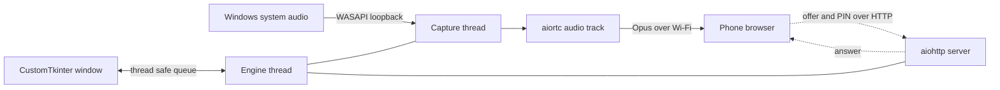

<div align="center">

# 🔊 PhoneSpeaker

### Turn any phone into a wireless speaker for your Windows laptop.
**No app on the phone. No cables. No ads. Just scan, tap Play, and listen.**

**Developed by Muhammad Sayban**
**At Sinecord Productions**

</div>

---

## ✨ Why this exists

The speaker of my laptop broke. Every app I found for using a phone as a speaker was either paid, full of ads, or needed an install on both devices. So I built my own: the laptop captures everything it plays, and the phone simply opens a web page and plays it live.

## 🚀 Features

| | |
|---|---|
| 📱 **Nothing to install on the phone** | Any modern browser works. Scan the QR code, tap Play. |
| ⚡ **Low delay streaming** | WebRTC with Opus audio over your local Wi-Fi, with Low, Balanced and Stable latency presets. |
| 🔐 **PIN protection** | A random PIN is created on first run. Wrong guesses are locked out after five tries. |
| 🖥️ **Clean desktop app** | Dark CustomTkinter window with the phone link, QR code, live connection status and an audio level meter. |
| 🔔 **Lives in the tray** | Closing the window keeps streaming in the background. Control it from the tray icon. |
| 🔄 **Start with Windows** | Optional auto start straight into the tray. |
| 🎧 **Follows your speaker** | Plug in headphones or change the default output and the capture switches by itself. |
| 📶 **Network aware** | If your Wi-Fi address changes, the link and QR code refresh automatically. |
| 🧾 **Log file** | Problems are written to a rotating log with a button to open the folder. |

## 🧠 How it works

Think of the engine as a radio station and the phone as a radio. The desktop window is only the remote control.



1. **Capture.** `pyaudiowpatch` records what the laptop plays through WASAPI loopback. Silence is filled in so the stream clock never stalls.
2. **Serve.** A small `aiohttp` server hands the phone a single page and does the WebRTC signaling. No internet or cloud server is needed.
3. **Stream.** `aiortc` sends the audio to the browser, which plays it after one tap. Browsers do not allow sound without a tap.
4. **Control.** The GUI never touches the engine directly. They talk through a queue, which keeps the window smooth and the stream stable.

## 📦 Quick start

### Option A: download the app
Grab the latest zip from the **Releases** page, extract the whole folder and run `PhoneSpeaker.exe`.

### Option B: run from source

```bash
git clone https://github.com/YOUR_USERNAME/PhoneSpeaker.git
cd PhoneSpeaker
pip install -r requirements.txt
python gui.py
```

Requirements: Windows 10 or 11, 64 bit, Python 3.10 or newer.

### Use it
1. Connect the phone and the laptop to the **same Wi-Fi**.
2. Scan the QR code in the app. The PIN is already inside it.
3. Tap **Play**. Everything the laptop plays now comes out of the phone.

On the first launch Windows Firewall will ask for permission. Allow it on **Private networks**, otherwise the phone cannot reach the link.

## ⚙️ Settings

| Setting | What it does |
|---|---|
| Port | The port of the web page. Default 8080. |
| Audio output to capture | Choose a speaker to record, or follow the default one. |
| Latency | Low for the least delay, Stable if the sound crackles on weak Wi-Fi. |
| Require PIN on phone | Turns the PIN on or off. Use 4 to 8 digits or press Random. |
| Start minimized to tray | Opens hidden in the tray. |
| Start server when app opens | Starts streaming as soon as the app launches. |
| Start with Windows | Launches the app at boot, minimized to the tray. |

Settings and logs live in `%APPDATA%\PhoneSpeaker`.

## 🛠️ Build your own exe

```bat
build.bat
```

This installs PyInstaller and builds a folder at `dist\PhoneSpeaker\`. It is a folder build on purpose: it starts faster at boot than a single file and triggers fewer antivirus warnings. Zip the whole folder to share it.

## 📁 Project structure

```
PhoneSpeaker/
├── gui.py              Desktop window, tray icon, settings tab
├── phonespeaker.py     Engine: audio capture, web server, WebRTC, PIN check
├── appsupport.py       Settings file, single instance lock, autostart, logging
├── phonespeaker.spec   PyInstaller recipe
├── build.bat           One click build
├── icon.ico            App icon
└── requirements.txt
```

## 🔒 Security notes

- The PIN stops other people on the same Wi-Fi from listening in. Five wrong tries lock that phone for a minute.
- The page and the PIN travel over plain HTTP inside your local network, so treat the PIN as a door lock, not a vault. The audio itself is encrypted by WebRTC.
- Use it on networks you trust. Public hotspots that isolate devices will not work at all, because the phone cannot reach the laptop.

## ❓ Troubleshooting

| Problem | Try this |
|---|---|
| The phone cannot open the link | Check both devices share the same Wi-Fi and allow the Firewall prompt on Private networks. |
| Connected but silent | Make sure the laptop is actually playing sound, and watch the audio level bar in the app. |
| Sound crackles | Set Latency to Stable and move closer to the router. |
| The phone stops playing after a while | Keep the screen on. Phones may pause audio in a sleeping browser tab. |
| Port already in use | Choose another port in Settings. |

Anything else is recorded in the log file. Use **Open log folder** in Settings.

## 🧭 Known limitations and ideas

- Windows only, because capture uses WASAPI loopback.
- One phone at a time. A new phone replaces the old one.
- There is a small delay, so it is great for music and calls but not perfect for tight lip sync.
- Ideas for later: multiple phones, volume control from the desktop, HTTPS with a local certificate.

## 🧰 Built with

[aiortc](https://github.com/aiortc/aiortc) · [aiohttp](https://github.com/aio-libs/aiohttp) · [PyAudioWPatch](https://github.com/s0d3s/PyAudioWPatch) · [CustomTkinter](https://github.com/TomSchimansky/CustomTkinter) · [pystray](https://github.com/moses-palmer/pystray) · [qrcode](https://github.com/lincolnloop/python-qrcode) · [PyInstaller](https://pyinstaller.org)

## 👤 Credits

**Developed by Muhammad Sayban**
**At Sinecord Productions**

Built with the help of Claude by Anthropic as an AI coding assistant.

## 📄 License

This project is free and open source and is released into the **public domain** under [The Unlicense](LICENSE). Anyone can use, copy, modify, share or sell it for any purpose, with no permission needed. The libraries it uses keep their own licenses.

---

<div align="center">

If this tool saved your laptop's day, consider giving the repo a ⭐

</div>
